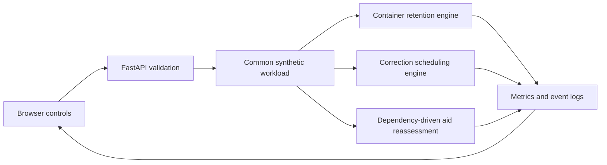
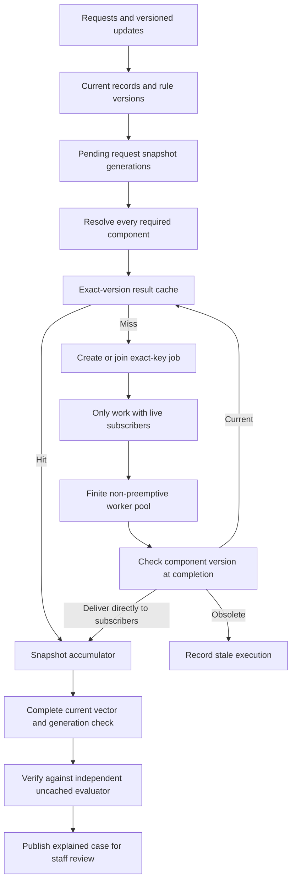

# Simulation architecture

## Shared structure



All three engines use event heaps and virtual milliseconds. Each comparison creates a fresh engine for every policy combination; an engine can run once. Decisions observe only events already processed. Deterministic ties make workload outcomes repeatable. Policy overhead is measured with the host clock, varies between runs, and is excluded from virtual latency. Percentiles use nearest rank; empty samples return zero.

## Warm-container engine

### Workload and capacity

| Function | Memory MiB | Startup ms | Execution ms |
| --- | ---: | ---: | ---: |
| Timetable | 128 | 100 | 20 |
| Assignment | 256 | 1500 | 80 |
| Semester report | 512 | 2500 | 150 |
| Fee payment | 128 | 800 | 60 |

`steady` calls each service twice (eight requests); `burst` has overlapping assignments (six); `shift` moves from timetable to report requests (six).

A container follows `STARTING → BUSY → IDLE → EVICTED`; reuse transitions `IDLE → BUSY`. One container serves one request at a time. Starting and busy containers are protected. Active capacity is assumed sufficient, so requests do not queue. The budget limits idle memory after completions. An oversized container can execute, then must be evicted.

At equal timestamps, startup/execution completions precede idle timeouts, then arrivals ordered by request ID. Events created with higher priority at the current timestamp run before the next arrival. Timeout tokens prevent an old timer from removing a reused container. Evaluation stops at the last request completion; idle memory is integrated from time zero to that point.

### Retention policies

| Policy | Eviction rule |
| --- | --- |
| Timeout + LRU | Expire after 1,200 ms idle; use LRU for earlier memory pressure |
| LRU | Lowest execution-completion recency |
| LFU | Lowest cumulative invocation count per function, then recency |
| Adapted FaasCache GDSF | Lowest `access_clock + function_frequency × startup_ms / memory_mib` |
| Recent demand | Lowest `estimated_reuse_probability × startup_ms / memory_mib` |
| Poisson marginal value | Lowest estimated startup delay avoided per MiB by retaining another copy, using Erlang blocking increments |
| Empirical marginal value | Same objective, estimating increments from observed warm-only shadow-slot assignments |

GDSF advances its logical clock on eviction. Each container records that clock when accessed. Function frequency resets when its last live copy is evicted. Recency and container ID break score ties.

Recent demand decays observed request counts with a 2,600 ms time constant and estimates reuse over 1,800 ms under a Poisson assumption. Every idle copy receives its function's score. Irregular arrivals and duplicate copies can undermine that estimate; it has no optimality guarantee.

The two experimental marginal policies distinguish execution overlap from copies created by long startup delays. Shadow slots are busy only for execution duration; they are updated once per observed arrival and their decayed hit rates are projected to a nonincreasing sequence. Erlang blocking increments supply an analytical comparator. For `k` current idle copies and `b(u)` protected copies returning within `u` ms, removal value is `startup_ms / memory_mib × integral[0,H] marginal_rate[k+b(u)] du`. Identical idle copies of a function share this removal value; it is recomputed after each eviction. This fixed-pool surrogate assumes returning copies remain available and does not model all future cold-copy replacement or memory pressure. [Experimental details](experiments/README.md) record the equations and limitations.

Metrics include cold/warm starts, total startup overhead, response latency, idle MiB-ms, average/peak idle memory, peak active memory, evictions, eviction-decision overhead and observation overhead. Request replay groups intervening removals for presentation while retaining the full event log. The larger policy study integrates memory to one common end per trace, including timeout expiry during the final idle tail; the short demo keeps its original last-completion endpoint.

## Exam correction engine

### Input and versioning

The model contains 16 synthetic students, four questions, two workers and a cache capacity of 48 equal-sized components. A cache key is:

```text
(exam, student, submission_version, question, rubric_version, grader_version)
```

Current rubric versions are tracked per student and question. A correction changes only its named students and question, invalidates their old-version keys, and creates one job per changed component. Repeated notices for an already current version create no jobs or cache probes.

| Scenario | Correction events | Base deadline offset |
| --- | --- | ---: |
| `single` | At 0 ms, q2 changes for eight students | 500 ms |
| `rush` | At 0 ms, q2 changes for all 16 | 300 ms |
| `shift` | At 0 ms, q2 changes for ten; at 40 ms, changes again for the first four | 350 ms |

Job duration is `45 + (student_index % 4) × 20` ms. Absolute deadlines add the scenario offset and repeating student offsets `120, 0, -80, 60` ms to the correction time.

### Queue and publication

At one timestamp, completions precede correction notices; all those events are processed before new dispatches. Already running jobs finish. Their target version is checked against the current version at completion, and stale results are discarded. Queued jobs superseded by a correction are removed without consuming worker time. A replacement job waits if the same student's question is already running. Every created job ends as `published`, `discarded_stale` or `superseded`.

| Scheduler | Priority, lowest first |
| --- | --- |
| FIFO | Release time, creation sequence, ID |
| EDF | Absolute deadline, release time, sequence, ID |
| Fair EDF | Remaining deadline time + accumulated student service − half waiting age; then EDF ties |

Fair EDF charges the student's estimated duration on dispatch, with equal student weights. This is a heuristic without a starvation guarantee.

### Result cache and metrics

The cache stores component metadata, not numeric grades. Initialization attempts to seed 64 old-version components into 48 slots. These 16 setup evictions are reported separately from runtime evictions. Unchanged questions are probed on correction: hits update frequency, recency and access clock. A probe miss does **not** schedule additional work. Consequently, cache policy changes cache activity, but does not change job duration or queue latency in this model.

LRU evicts the least recent entry. GDSF uses `access_clock + accesses × recomputation_cost_ms` because every entry has unit size. Its logical clock advances on eviction. Updating an existing entry refreshes its cost, frequency, recency and access clock. Corrections invalidate only the relevant old-version entries; other students and questions retain their versions.

Published counts and deadline/latency metrics describe individual published jobs, including jobs published before a later amendment. They are not final student grades. Recomputed components count executed jobs, including discarded stale work; superseded queued jobs consume no execution. Queue wait covers dispatched jobs. Cache counters report hits, misses, invalidations, admissions, runtime evictions and initial evictions. Worker busy time includes all executed work.

## Boundaries

There is no actual grading, aggregate-score calculation, Docker backend, network delay, cloud deployment or measured learning outcome. These examples explain algorithm behavior. The adapted policies and synthetic timings require larger traces and external measurements before drawing research conclusions.

## Dependency-driven aid reassessment

This iteration is implemented in `reassessment.py`, `aid_domain.py` and `result_cache.py`, with an API at `/api/reassessments` and a browser interface at `/reassessments`. It uses synthetic financial-aid checks and keeps the original exam-correction engine as a separate study.

### Data and ownership

| Module | Responsibility |
| --- | --- |
| `aid_domain.py` | Immutable component keys and computed check values; separate uncached reference evaluator |
| `result_cache.py` | Bounded equal-slot LRU/GDSF storage of actual results and recomputation costs |
| `reassessment.py` | Version state, snapshot generations, dependency planning, exact-key work registry, finite workers, scheduling, publication and metrics |
| `app.py` and `static/reassessments.js` | Validated configuration and display of policy comparisons, cases, component jobs and events |

Each record has academic CGPA in hundredths, annual household income in INR, and a boolean evidence-verification flag. The three illustrative rules are CGPA at least 8.00, income at most INR 300,000, and verified evidence. The amendments scenario changes the academic rule to 8.20. These are invented rules, not VIT policy. Outputs explain checks for staff review; they do not award financial aid.

A component key includes application, student, check, the scoped record version, the check's rule version and evaluator version. Only that check's input is included in its dependency version. Rule updates affect the named check for all students; record updates affect the named students and check. A repeated version/value is a no-op. Regressing a version or changing its value without advancing the version is rejected.

### Execution flow



A hit delivers an immutable computed value. A miss creates one computation or joins the job already registered for that exact key. Every job has a unique ID separate from its key. Jobs capture immutable input values and compute their result at completion, after consuming their configured virtual duration. An academic job costs 40 ms, income 100 ms and evidence 60 ms in the demonstration inputs.

At a timestamp, record/rule updates precede completions, then new requests and cancellations. The engine then refreshes pending targets, plans dependencies, cancels orphaned queued jobs, publishes complete snapshots and dispatches. Completions are never published before same-time updates have taken effect. A same-time cancellation also prevents case publication.

A changed target supersedes the old generation. The logical request keeps its original release and absolute deadline. Valid delivered values can be carried into its replacement generation, even if evicted from the cache. Planning reattaches unchanged in-flight work before cancelling jobs that have lost all subscribers. Cancelling one request never removes work still required by another subscriber. Running orphaned jobs finish; obsolete versions are discarded before cache admission or delivery.

FIFO uses creation/release ordering. EDF uses the earliest absolute deadline among a job's current subscribers. Fair EDF adds per-student dispatched service and waiting-age relief. Dispatch prevents simultaneous jobs for the same student/check, including different versions. There is no starvation proof.

Publication requires every component, the request's current generation and the full current key vector. Its boolean results are checked against an independent evaluator reading the current raw record and rules. Failure of this invariant raises an error rather than silently accepting the result. A published case remains historical after a later amendment; another request is required to reassess it. The API's `current_at_end` flag distinguishes such historical output from current output.

### Resource and baseline definitions

LRU and GDSF retain actual values within a configured result-slot budget. GDSF uses an access clock plus frequency multiplied by recomputation duration; equal entry size is assumed. No-cache sets retention capacity to zero but still deduplicates overlapping work and preserves delivered values within a request. Full recomputation also disables exact-key deduplication and carry-over into amended generations. All strategies use identical version-safety, worker and cancellation rules.

Cache slots and live accumulator components are counted separately. Debug history, event logs and completed output records are not charged to either simulated budget. These counts are not bounds on process RAM. Worker computation is summed virtual execution, not elapsed wall time. Metric definitions, including joined-cost counters and unused-current work, are specified in [the reassessment study](experiments/REASSESSMENT_STUDY.md).

### Current evaluation and remaining integration

The test suite includes independent reconstruction of each record/rule vector at publication, cache eviction with retained accumulator values, cancellation of shared subscribers, exact-time boundaries, repeated amendments and generated traces. The exporter covers 540 deterministic workload/resource/policy combinations and writes results plus source hashes. No-cache and full-recompute baselines are available in both the API and interface.

The new engine does not yet execute jobs through the warm-container pool. Startup/retention coupling, total host-memory admission, calibrated costs, public workloads and a real institutional pilot remain separate next steps. The existing paper's results describe the earlier revision and have not been rewritten for this implementation.
