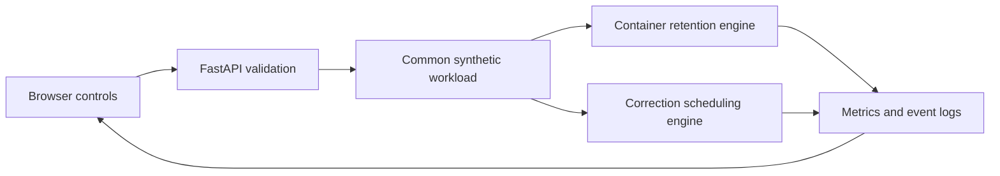

# Simulation architecture

## Shared structure



Both engines use event heaps and virtual milliseconds. Each comparison creates a fresh engine for every policy combination; an engine can run once. Decisions observe only events already processed. Deterministic ties make workload outcomes repeatable. Policy overhead is measured with the host clock, varies between runs, and is excluded from virtual latency. Percentiles use nearest rank; empty samples return zero.

## Warm-container engine

### Workload and capacity

| Function | Memory MiB | Startup ms | Execution ms |
| --- | ---: | ---: | ---: |
| Timetable | 128 | 100 | 20 |
| Assignment | 256 | 1500 | 80 |
| Semester report | 512 | 2500 | 150 |
| Fee payment | 128 | 800 | 60 |

`steady` calls each service twice (eight requests); `burst` has overlapping assignments (six); `shift` moves from timetable to report requests (six).

A container follows `STARTING → BUSY → IDLE → EVICTED`; reuse transitions `IDLE → BUSY`. One container serves one request at a time. Starting and busy containers are protected. Active capacity is assumed sufficient, so requests do not queue. The budget limits idle memory after completions. An oversized container can execute, then must be evicted.

At equal timestamps, startup/execution completions precede idle timeouts, then arrivals ordered by request ID. Events created with higher priority at the current timestamp run before the next arrival. Timeout tokens prevent an old timer from removing a reused container. Evaluation stops at the last request completion; idle memory is integrated from time zero to that point.

### Retention policies

| Policy | Eviction rule |
| --- | --- |
| Timeout + LRU | Expire after 1,200 ms idle; use LRU for earlier memory pressure |
| LRU | Lowest execution-completion recency |
| LFU | Lowest cumulative invocation count per function, then recency |
| Adapted FaasCache GDSF | Lowest `access_clock + function_frequency × startup_ms / memory_mib` |
| Recent demand | Lowest `estimated_reuse_probability × startup_ms / memory_mib` |

GDSF advances its logical clock on eviction. Each container records that clock when accessed. Function frequency resets when its last live copy is evicted. Recency and container ID break score ties.

Recent demand decays observed request counts with a 2,600 ms time constant and estimates reuse over 1,800 ms under a Poisson assumption. Every idle copy receives its function's score. Irregular arrivals and duplicate copies can undermine that estimate; it has no optimality guarantee.

Metrics include cold/warm starts, total startup overhead, response latency, idle MiB-ms, average/peak idle memory, peak active memory, evictions and policy overhead. Request replay groups intervening removals for presentation while retaining the full event log.

## Exam correction engine

### Input and versioning

The model contains 16 synthetic students, four questions, two workers and a cache capacity of 48 equal-sized components. A cache key is:

```text
(exam, student, submission_version, question, rubric_version, grader_version)
```

Current rubric versions are tracked per student and question. A correction changes only its named students and question, invalidates their old-version keys, and creates one job per changed component. Repeated notices for an already current version create no jobs or cache probes.

| Scenario | Correction events | Base deadline offset |
| --- | --- | ---: |
| `single` | At 0 ms, q2 changes for eight students | 500 ms |
| `rush` | At 0 ms, q2 changes for all 16 | 300 ms |
| `shift` | At 0 ms, q2 changes for ten; at 40 ms, changes again for the first four | 350 ms |

Job duration is `45 + (student_index % 4) × 20` ms. Absolute deadlines add the scenario offset and repeating student offsets `120, 0, -80, 60` ms to the correction time.

### Queue and publication

At one timestamp, completions precede correction notices; all those events are processed before new dispatches. Already running jobs finish. Their target version is checked against the current version at completion, and stale results are discarded. Queued jobs superseded by a correction are removed without consuming worker time. A replacement job waits if the same student's question is already running. Every created job ends as `published`, `discarded_stale` or `superseded`.

| Scheduler | Priority, lowest first |
| --- | --- |
| FIFO | Release time, creation sequence, ID |
| EDF | Absolute deadline, release time, sequence, ID |
| Fair EDF | Remaining deadline time + accumulated student service − half waiting age; then EDF ties |

Fair EDF charges the student's estimated duration on dispatch, with equal student weights. This is a heuristic without a starvation guarantee.

### Result cache and metrics

The cache stores component metadata, not numeric grades. Initialization attempts to seed 64 old-version components into 48 slots. These 16 setup evictions are reported separately from runtime evictions. Unchanged questions are probed on correction: hits update frequency, recency and access clock. A probe miss does **not** schedule additional work. Consequently, cache policy changes cache activity, but does not change job duration or queue latency in this model.

LRU evicts the least recent entry. GDSF uses `access_clock + accesses × recomputation_cost_ms` because every entry has unit size. Its logical clock advances on eviction. Updating an existing entry refreshes its cost, frequency, recency and access clock. Corrections invalidate only the relevant old-version entries; other students and questions retain their versions.

Published counts and deadline/latency metrics describe individual published jobs, including jobs published before a later amendment. They are not final student grades. Recomputed components count executed jobs, including discarded stale work; superseded queued jobs consume no execution. Queue wait covers dispatched jobs. Cache counters report hits, misses, invalidations, admissions, runtime evictions and initial evictions. Worker busy time includes all executed work.

## Boundaries

There is no actual grading, aggregate-score calculation, Docker backend, network delay, cloud deployment or measured learning outcome. These examples explain algorithm behavior. The adapted policies and synthetic timings require larger traces and external measurements before drawing research conclusions.
