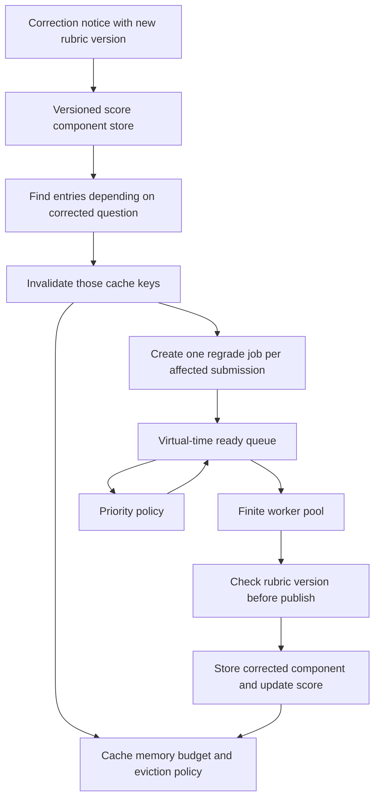

# Exam Correction Simulator: Architecture

## Goal

Add a separate, reproducible workload to the existing serverless lab demo. The scenario models an institution correcting one exam question after grading. Only score components that depend on the corrected rubric are recomputed; results tied to unchanged rubric versions remain reusable. A finite worker pool makes queue scheduling measurable.

This is a simulation feature, not a grading product. It uses synthetic submissions and deterministic grading costs. It does not make student decisions or handle real learner records.

## Components and flow

### Request and data model

- A cached component key includes exam, submission content version, question, rubric version, and grader version. An old result can never satisfy a lookup for a new rubric version.
- A correction identifies affected students and invalidates only their entries for the changed question and old rubric version. The small prototype scans its bounded cache; a larger deployment would add an index over those fields. The current rubric version is tracked per student and question so corrections to one cohort do not supersede another cohort's work.
- Work items contain an ID, student ID, release time, absolute deadline, estimated service duration, question, and target rubric version. IDs break all scheduling ties deterministically.
- Synthetic exams contain several independently graded questions so that selective invalidation leaves valid cached components to reuse.

### Event engine

Use virtual milliseconds and a discrete-event heap. Completion events run before simultaneous releases. Work in progress is not canceled. Before publishing a result, the worker compares its target rubric version with the current version. A stale result is discarded and the newest version is queued if required. Idle workers immediately receive the next ready job. Capacity is fixed for each run and requests queue instead of creating unbounded workers.

### Scheduling policies

- FIFO: earliest release time, then work ID.
- EDF: earliest absolute deadline, then release time and work ID.
- Fair EDF: remaining time to the deadline plus a per-student accumulated-service penalty, minus half the waiting age. Service advances by estimated duration after dispatch, with equal weights per student. This is a fairness heuristic without a guaranteed starvation bound.

The initial fair-share is equal per student. Priority component values are returned with each dispatch for explanation. The policy is a heuristic; no optimality guarantee is claimed.

### Result cache

- Versioned keys provide correctness and local invalidation; no global flush is needed for a one-question correction.
- Cache hits update recency, access frequency, and estimated recomputation cost.
- When a storage budget is exceeded, compare LRU with a size/cost/frequency-aware Greedy-Dual score. Retain deterministic tie breakers. Cache capacity is expressed in score-component units for easy inspection.
- Store cache counters for hits, misses, invalidations, admissions, and evictions. Cache loss may cause recomputation but never changes correctness.

### Interface and comparison

Keep the college cold-start interface and its `/api/run` behavior. Add `/corrections` and `/api/corrections` as a distinct feature. Every scheduler and cache policy receives identical synthetic submissions, deadlines, correction events, worker count, and cache budget. Report completion latency, p95, deadline misses, queue wait, recomputed components, cache activity, and worker busy time. All outputs identify themselves as simulated.

### First implementation boundary

Implement deterministic correction scenarios, including an overlapping amendment, selective versioned invalidation, three schedulers, two cache eviction policies, finite workers, varied synthetic appeal deadlines, JSON API, and a small explainer page. Defer actual OCR/essay grading, real student data, multi-server placement, learning-outcome measurement, and Docker execution.

### Acceptance evidence

Use independent scenarios that expose (1) only changed-question entries being invalidated, (2) identical workload replay across policy choices, (3) FIFO versus deadline ordering, (4) fair service across students during a burst, (5) valid cache entries surviving an unrelated correction, and (6) stale work being prevented from publishing. Record actual verification separately from simulated results.
