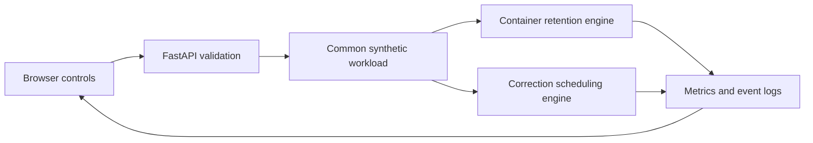
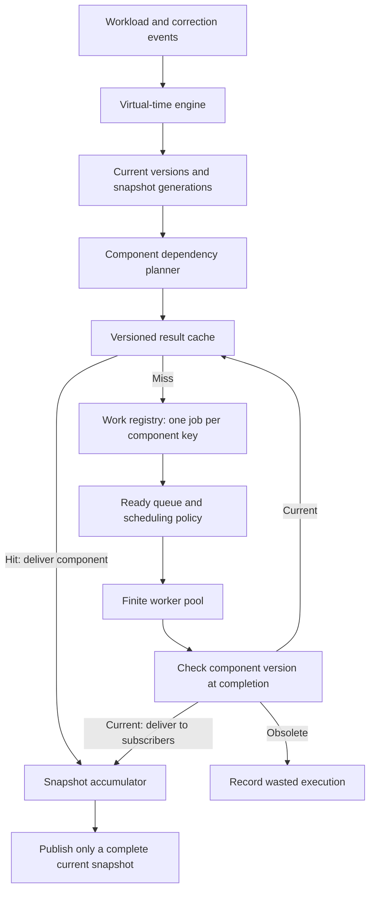

# Simulation architecture

## Shared structure



Both engines use event heaps and virtual milliseconds. Each comparison creates a fresh engine for every policy combination; an engine can run once. Decisions observe only events already processed. Deterministic ties make workload outcomes repeatable. Policy overhead is measured with the host clock, varies between runs, and is excluded from virtual latency. Percentiles use nearest rank; empty samples return zero.

## Warm-container engine

### Workload and capacity

| Function | Memory MiB | Startup ms | Execution ms |
| --- | ---: | ---: | ---: |
| Timetable | 128 | 100 | 20 |
| Assignment | 256 | 1500 | 80 |
| Semester report | 512 | 2500 | 150 |
| Fee payment | 128 | 800 | 60 |

`steady` calls each service twice (eight requests); `burst` has overlapping assignments (six); `shift` moves from timetable to report requests (six).

A container follows `STARTING → BUSY → IDLE → EVICTED`; reuse transitions `IDLE → BUSY`. One container serves one request at a time. Starting and busy containers are protected. Active capacity is assumed sufficient, so requests do not queue. The budget limits idle memory after completions. An oversized container can execute, then must be evicted.

At equal timestamps, startup/execution completions precede idle timeouts, then arrivals ordered by request ID. Events created with higher priority at the current timestamp run before the next arrival. Timeout tokens prevent an old timer from removing a reused container. Evaluation stops at the last request completion; idle memory is integrated from time zero to that point.

### Retention policies

| Policy | Eviction rule |
| --- | --- |
| Timeout + LRU | Expire after 1,200 ms idle; use LRU for earlier memory pressure |
| LRU | Lowest execution-completion recency |
| LFU | Lowest cumulative invocation count per function, then recency |
| Adapted FaasCache GDSF | Lowest `access_clock + function_frequency × startup_ms / memory_mib` |
| Recent demand | Lowest `estimated_reuse_probability × startup_ms / memory_mib` |
| Poisson marginal value | Lowest estimated startup delay avoided per MiB by retaining another copy, using Erlang blocking increments |
| Empirical marginal value | Same objective, estimating increments from observed warm-only shadow-slot assignments |

GDSF advances its logical clock on eviction. Each container records that clock when accessed. Function frequency resets when its last live copy is evicted. Recency and container ID break score ties.

Recent demand decays observed request counts with a 2,600 ms time constant and estimates reuse over 1,800 ms under a Poisson assumption. Every idle copy receives its function's score. Irregular arrivals and duplicate copies can undermine that estimate; it has no optimality guarantee.

The two experimental marginal policies distinguish execution overlap from copies created by long startup delays. Shadow slots are busy only for execution duration; they are updated once per observed arrival and their decayed hit rates are projected to a nonincreasing sequence. Erlang blocking increments supply an analytical comparator. For `k` current idle copies and `b(u)` protected copies returning within `u` ms, removal value is `startup_ms / memory_mib × integral[0,H] marginal_rate[k+b(u)] du`. Identical idle copies of a function share this removal value; it is recomputed after each eviction. This fixed-pool surrogate assumes returning copies remain available and does not model all future cold-copy replacement or memory pressure. [Experimental details](experiments/README.md) record the equations and limitations.

Metrics include cold/warm starts, total startup overhead, response latency, idle MiB-ms, average/peak idle memory, peak active memory, evictions, eviction-decision overhead and observation overhead. Request replay groups intervening removals for presentation while retaining the full event log. The larger policy study integrates memory to one common end per trace, including timeout expiry during the final idle tail; the short demo keeps its original last-completion endpoint.

## Exam correction engine

### Input and versioning

The model contains 16 synthetic students, four questions, two workers and a cache capacity of 48 equal-sized components. A cache key is:

```text
(exam, student, submission_version, question, rubric_version, grader_version)
```

Current rubric versions are tracked per student and question. A correction changes only its named students and question, invalidates their old-version keys, and creates one job per changed component. Repeated notices for an already current version create no jobs or cache probes.

| Scenario | Correction events | Base deadline offset |
| --- | --- | ---: |
| `single` | At 0 ms, q2 changes for eight students | 500 ms |
| `rush` | At 0 ms, q2 changes for all 16 | 300 ms |
| `shift` | At 0 ms, q2 changes for ten; at 40 ms, changes again for the first four | 350 ms |

Job duration is `45 + (student_index % 4) × 20` ms. Absolute deadlines add the scenario offset and repeating student offsets `120, 0, -80, 60` ms to the correction time.

### Queue and publication

At one timestamp, completions precede correction notices; all those events are processed before new dispatches. Already running jobs finish. Their target version is checked against the current version at completion, and stale results are discarded. Queued jobs superseded by a correction are removed without consuming worker time. A replacement job waits if the same student's question is already running. Every created job ends as `published`, `discarded_stale` or `superseded`.

| Scheduler | Priority, lowest first |
| --- | --- |
| FIFO | Release time, creation sequence, ID |
| EDF | Absolute deadline, release time, sequence, ID |
| Fair EDF | Remaining deadline time + accumulated student service − half waiting age; then EDF ties |

Fair EDF charges the student's estimated duration on dispatch, with equal student weights. This is a heuristic without a starvation guarantee.

### Result cache and metrics

The cache stores component metadata, not numeric grades. Initialization attempts to seed 64 old-version components into 48 slots. These 16 setup evictions are reported separately from runtime evictions. Unchanged questions are probed on correction: hits update frequency, recency and access clock. A probe miss does **not** schedule additional work. Consequently, cache policy changes cache activity, but does not change job duration or queue latency in this model.

LRU evicts the least recent entry. GDSF uses `access_clock + accesses × recomputation_cost_ms` because every entry has unit size. Its logical clock advances on eviction. Updating an existing entry refreshes its cost, frequency, recency and access clock. Corrections invalidate only the relevant old-version entries; other students and questions retain their versions.

Published counts and deadline/latency metrics describe individual published jobs, including jobs published before a later amendment. They are not final student grades. Recomputed components count executed jobs, including discarded stale work; superseded queued jobs consume no execution. Queue wait covers dispatched jobs. Cache counters report hits, misses, invalidations, admissions, runtime evictions and initial evictions. Worker busy time includes all executed work.

## Boundaries

There is no actual grading, aggregate-score calculation, Docker backend, network delay, cloud deployment or measured learning outcome. These examples explain algorithm behavior. The adapted policies and synthetic timings require larger traces and external measurements before drawing research conclusions.

## Proposed next iteration: correction dependencies and cache-driven work

This section is a design draft. It assumes the next focus is a local exam-correction simulation; the scope is awaiting discussion. The preceding sections describe the implemented system.

### Objective

Measure how result caching and scheduling jointly affect the time needed to publish a current result after overlapping corrections. Cache misses must have an execution cost. The unit of completion becomes a consistent result for one student's requested rubric snapshot, rather than an individual published job.

### Flow and ownership



The engine alone advances time and mutates run state. Policies select jobs or eviction victims; they do not publish results or change version state. The planner determines dependencies. The work registry deduplicates simultaneous requests for the same exact component key. The publisher verifies the full target version vector and generation before accepting a snapshot.

### Data and correctness rules

- Keep the existing component key, including student, submission, question, rubric and grader versions.
- Give every requested student snapshot a unique ID, generation, target version vector, release time and absolute deadline. Job IDs are distinct from component keys so job histories cannot overwrite one another.
- Cache entries contain deterministic synthetic component values, their size, recomputation cost and policy metadata. Synthetic values let the simulator check the final aggregate independently of scheduling order.
- Resolve all required questions: a hit satisfies a dependency; a miss creates or joins a computation. A result request completes only after every dependency is satisfied.
- A correction replaces affected snapshot targets. Unchanged exact-version components remain reusable. Remove queued computations with no live subscribers; running work finishes and is checked before admission or delivery.
- Deduplicate by full component key, allowing many snapshot subscribers to share one computation. Canceling one subscriber must not cancel work another current subscriber needs.
- Consume delivered values into the snapshot accumulator. Later cache eviction must not undo a satisfied dependency. Report cache storage separately from transient accumulator storage.
- Preserve a pending request's absolute deadline through amendments. A new request has its own deadline; version changes must not silently extend existing deadlines.
- At an equal timestamp, apply corrections before accepting completions, then resolve dependencies and dispatch. This proposed ordering makes the correction effective for every publication at that timestamp. It intentionally differs from the current completion-first engine and needs explicit regression coverage.

### Policies and resource model

Start with FIFO and EDF scheduling, then compare the existing fair EDF heuristic. Keep LRU and equal-size GDSF as result-cache baselines. Scheduling considers only ready jobs with unsatisfied live demand; cache hits consume no worker slot. Cache lookup, grading and aggregation durations are configured virtual costs shared across policies.

First model a finite worker count and bounded result cache. Once dependency behavior is validated, add startup delay and warm-container retention to those workers. Specify execution-memory and result-cache budgets separately; any later total-host constraint must account for both. Physical memory admission and eviction require their own rules before claiming a total memory limit.

### Suggested module boundaries

| Module | Owns |
| --- | --- |
| Event engine | Clock, event ordering and run orchestration |
| Domain records | Immutable events, component keys, jobs and snapshot targets |
| Dependency planner | Missing components, subscribers and affected snapshots |
| Version state and publisher | Current generations and publication checks |
| Result cache | Admission, lookup, invalidation and eviction |
| Scheduling policies | Selection from eligible ready work |
| Worker pool | Execution capacity, durations and completion events |
| Metrics collector | Request outcomes, job outcomes, memory and waste |

Use these as ownership boundaries. Split files when a boundary has independent behavior; the draft does not require creating every module immediately. The API and browser remain adapters around the engine.

### Evaluation and implementation sequence

1. Add synthetic values, snapshot targets and dependencies. Verify the final aggregate with a simple uncached reference evaluator.
2. Make misses schedule work and add exact-key deduplication. Verify eviction affects work performed without changing the accepted aggregate.
3. Add generation-safe publication and repeated amendments, including same-time correction/completion cases.
4. Compare schedulers and cache policies on identical seeded traces, with cache disabled and a full-recompute strategy as additional baselines.
5. Introduce worker startup and retention, then measure the combined effect in a separate experiment.

Report latest-snapshot completion latency, deadline misses, actual compute time avoided, duplicate work avoided, obsolete execution time, queue wait, cache activity and memory usage. Keep superseded requests separate from completed or missed requests, and include unfinished requests in an explicit end-of-run count. Vary amendment rate, deadline tightness, service-cost skew, worker count and cache capacity. Treat any improvement as a hypothesis until those comparisons support it.
