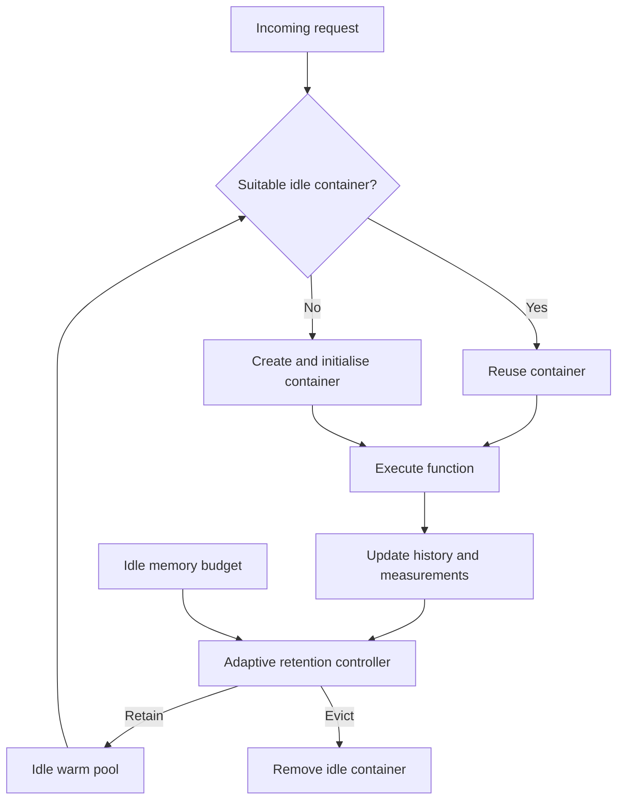

# OS Lab project: Adaptive Warm-Container Retention

## Instruction to Codex CLI

Continue this project from the specification below. Inspect the current directory and any AGENTS.md instructions first, preserve existing work, then implement Milestone 1 and run its verification. Make routine implementation choices autonomously and explain them. Do not stop at a plan: deliver a working simulator, example workloads, policy comparisons, meaningful tests, and run instructions. Record completed work and next steps in PROGRESS.md. Later milestones are a roadmap, not part of the first build.

## Context and objective

This is a VIT Operating Systems lab research project by Advay Vivek and Priyank G. The chosen topic is reducing serverless cold-start delays through adaptive retention of idle containers under a fixed memory budget.

Serverless functions need an execution environment containing their runtime, code, and dependencies. If a suitable idle environment exists, a request can reuse it. Otherwise, creating and initialising one adds cold-start delay. Retaining idle containers avoids some future starts but consumes memory even when no work is running.

The central question: which idle containers should remain warm when available memory cannot retain every function, and invocation patterns change over time?

Proposed controller: estimate near-term reuse from past invocations, combine this estimate with startup penalty and memory footprint, and evict lower-value idle containers to respect the budget. Active containers must never be evicted.

OS connections: cache replacement, memory allocation, resource accounting, lifecycle management, scheduling, and latency/resource trade-offs.

## Problem statement

Serverless functions experience additional response latency when a suitable execution environment is unavailable and the platform must allocate resources, initialise the runtime, and load code and dependencies. Retaining previously used containers in a warm state can reduce subsequent cold starts, but these idle environments occupy memory that could support other functions. Under a constrained retention budget, maintaining every environment is impractical.

Retention decisions become harder when functions differ in invocation frequency, burst behaviour, startup cost, and memory requirements. Fixed idle timeouts do not account for all these differences. Recency-only or frequency-only policies may retain environments offering little benefit while evicting an expensive environment that is likely to be reused. Historical popularity can also lag behind changing demand.

This project will develop and evaluate a lightweight adaptive retention controller that uses recent invocation history, startup penalties, and idle memory consumption to update retention priorities. The controller will retain higher-value idle containers and evict lower-value ones when required by the memory budget. Evaluation will compare the proposed heuristic with fixed-timeout, LRU, and LFU policies under identical steady, bursty, and shifting workloads. Measurements will include cold-start percentage, average and tail response latency, idle memory over time, and controller overhead. Improvement is a hypothesis to test, not a guaranteed result.

## College-portal example

The following numbers are illustrative simulation inputs, not measured production results.

| Function | Memory MiB | Cold-start penalty ms | Execution ms | Illustrative reuse probability over 60 s |
| --- | ---: | ---: | ---: | ---: |
| Timetable | 128 | 100 | 20 | 0.95 |
| Assignment processing | 256 | 1500 | 80 | 0.70 |
| Semester report | 512 | 2500 | 150 | 0.05 |
| Fee payment | 128 | 800 | 60 | 0.40 |

Idle retention budget: 512 MiB. All four idle containers need 1024 MiB.

Candidate score: reuse_probability * cold_start_ms / memory_mib.

The example scores are approximately 0.742, 4.102, 0.244, and 2.500 respectively. With these illustrative probabilities, retaining assignment, payment, and timetable consumes exactly 512 MiB. The semester-report instance is evicted. A cold assignment request takes 1580 ms versus 80 ms when warm, excluding network and queueing delays.

The probabilities in this table are only for explaining and testing score arithmetic. During experiments the policy must estimate demand causally from observed history; never supply future workload knowledge or hard-code these probabilities as predictions.

## Proposed architecture



## Milestone 1: reproducible simulator and comparisons

Implementation default: Python 3, suitable for discrete-event simulation and experiments. Keep the engine dependency-light, use pytest for meaningful tests, and optionally matplotlib for saved charts. Detect installed Python and document the supported version. Provide Windows PowerShell run instructions, using a project virtual environment. Do not require Docker or paid cloud services for this milestone.

Suggested structure, adjustable if existing code warrants it:

```text
src/serverless_sim/
    models.py
    engine.py
    workloads.py
    metrics.py
    cli.py
    policies/
        base.py
        timeout.py
        lru.py
        lfu.py
        adaptive.py
configs/
tests/
results/
README.md
PROGRESS.md
```

### Simulation contract

- Use virtual time, not sleeps. Trace inputs contain request ID, arrival time in milliseconds, and function ID. Function configuration contains positive memory MiB, nonnegative cold-start penalty, and nonnegative execution duration.
- Explicit states: STARTING, BUSY, IDLE, EVICTED. One container serves one request at a time. An idle container becomes BUSY on a warm hit; a cold miss creates a STARTING container that becomes BUSY after startup. On execution completion it becomes IDLE and undergoes retention decisions.
- Model overlapping arrivals correctly. A busy or starting container cannot serve another request. Additional containers may be created on concurrent misses; they become retention candidates when idle. This is reactive demand, not predictive pre-warming.
- First version bounds idle memory only. Assume sufficient active capacity; track active memory separately and state explicitly that this is not a total physical-host memory limit. Do not simulate queueing or claim realistic capacity planning without modelling active capacity.
- A container larger than the idle budget may execute under this assumption but cannot remain in the idle pool. A zero idle budget is valid and retains nothing.
- Start each policy/run from an empty system and empty history. Use the same trace and function configuration for all policies. Sort equal-time events deterministically: complete startup/execution and process timeout events before arrivals, then order equal-time arrivals by request ID. Document exact tie-breaking and zero-duration handling.
- Enforce the idle budget whenever idle candidates are admitted or budgets change. Remove stale timer events safely. Running containers are never eviction candidates.
- Continue virtual time until all requests finish. Integrate idle memory over the explicit evaluation interval from time zero to the last completion; report this interval. Do not add a policy-specific drain period that changes comparability.
- Record request latency as completion minus arrival; separately report simulated startup and execution durations. Instrument controller wall-clock time separately; do not silently mix it into virtual response latency.
- Validate traces and configuration, and produce useful errors for unknown functions, invalid timestamps, duplicate request IDs, or invalid resource values.

### Policies

1. Fixed timeout: expire an idle container after a configurable duration; use LRU eviction when the memory budget is exceeded before expiry. Call the baseline timeout+LRU in output so the combined rule is explicit.
2. LRU: evict the eligible container least recently used/completed; define and document which timestamp applies.
3. LFU: use observed cumulative per-function invocation counts; deterministic recency/container-ID tie-breaks. State that cumulative frequency can lag demand shifts.
4. Adaptive: start with score_i = p_i(H) * cold_start_ms_i / memory_mib_i. Evict the lowest-score idle candidate, recomputing causal priorities at decision time. This ratio heuristic is not an optimal knapsack solution and does not guarantee the best retained set.

Candidate initial reuse estimator: exponentially decayed request intensity per function. Maintain q and its last update time. At an invocation at t, update q = q * exp(-(t - previous_update)/tau) + 1. At a decision time t, estimate lambda = q * exp(-(t - last_update)/tau) / tau, then p(H) = 1 - exp(-lambda * H). H and tau are configured in milliseconds; lambda is per millisecond. A function with no past requests has zero estimated intensity. State the Poisson assumption and limitations for periodic or irregular bursts. Log the score components so behaviour is explainable.

Only use arrivals already observed at the current time, including the current arrival when updating history. Count arrivals even on cold misses. For multiple idle copies of the same function, disclose that the initial per-function score gives copies equal benefit and may overvalue extra copies; deterministic ties are acceptable for the first version. Add a later concurrency-aware marginal benefit estimator to the roadmap rather than claiming this weakness is solved.

### Workloads and outputs

- Include a small hand-checkable trace, a steady workload, a burst workload, and a workload shifting from timetable/assignment demand to report demand.
- Generate fixed-seed synthetic traces once and replay them for every policy. Include multiple seeds for stochastic comparisons and at least budgets 256, 512, and 1024 MiB.
- Output request-level CSV, eviction/retention event logs, idle-memory timeline, and summary CSV/JSON. Preserve trace, config, seed, estimator parameters, and revision identifier when available with each experiment.
- Metrics: requests, cold starts, cold-start percentage, average/p95/p99 latency, idle MiB-ms and average/peak idle MiB, active-memory peak, eviction count, policy decision count and wall-clock duration. Define the percentile method and zero-request output.
- Produce concise comparison tables and charts if plotting dependencies are available. Label every result as simulated. Report workloads where adaptive loses as well as where it wins.

### Verification and completion criteria

Write meaningful tests for first-request cold start then reuse, a budget-forced eviction, timeout expiry, overlapping requests causing a cold miss, oversized-container disposal, zero idle budget, no future-data access, idle-memory integration, and reproducible traces. Assert active instances are never evicted and idle memory remains within the budget after decisions. Check the example score arithmetic independently.

Milestone 1 is complete when a documented command runs the portal example and comparative experiments, all four policies use identical traces, the tests pass, outputs include the specified metrics, and README explains assumptions and limits. Provide exact commands, actual verification results, and next steps. Do not fabricate benchmark outcomes.

## Milestone 2: real-container validation

Add a replaceable execution backend using Docker only after the simulator works. Use sample functions with actual runtime/dependency initialization. Measure create-to-ready startup, request duration, and idle memory; distinguish container limits from observed consumption and account for measurement overhead. Artificial sleeps remain labelled demonstration inputs. Keep image versions, hardware, warm-up conditions, and network exclusions documented. Compare the same policies with controlled traces. Busy containers remain protected. Confirm the local Docker environment before choosing Windows/WSL integration.

## Milestone 3: research evaluation

Study sensitivity to H, tau, workload changes, and memory budgets. Add ablations to isolate reuse prediction, startup penalty, and memory normalisation. Avoid tuning on the reported test trace. Consider a verified implementation of FaasCache as a stronger baseline after checking the actual paper; do not label a rough heuristic as a faithful reproduction. Future extensions may include concurrency-aware marginal retention, active-capacity constraints, predictive pre-warming, shared dependencies, or multi-node placement.

## Research context and evidence limits

Relevant previously selected studies: FaasCache (2021, DOI 10.1145/3445814.3446757); RainbowCake (2024, DOI 10.1145/3617232.3624871); CASR (2025, DOI 10.1016/j.future.2025.107851); Medes (2022, DOI 10.1145/3492321.3524272); Serverless Cold Starts and Where to Find Them (2025, DOI 10.1145/3689031.3696073). Check primary sources before implementing their algorithms or making paper-specific claims.

Value-based adaptive caching already exists. The proposed score alone does not establish novelty. The contribution must be a specified adaptation rule or extension supported by experiments.

The assessment requires at least 30 peer-reviewed papers from 2021–2026 from reputable publishers, with comparative analysis of methods, datasets, metrics, findings, and limitations. The previous downloaded collection reportedly contains 24 PDFs; the old review list included seven pre-2021 references and two unverified references (#5 and #11). These records require correction before final submission. Do not assert that a valid 30-paper survey is complete, or invent missing references. The collection is separate from this handoff and is not bundled here.

## Starting action

Implement Milestone 1 now. First inspect this project folder, create a short implementation plan and PROGRESS.md, then build and verify the simulator. Keep the explanation clear enough for a student to demonstrate the request lifecycle, retention score, budget enforcement, and policy comparisons during an OS lab review.
